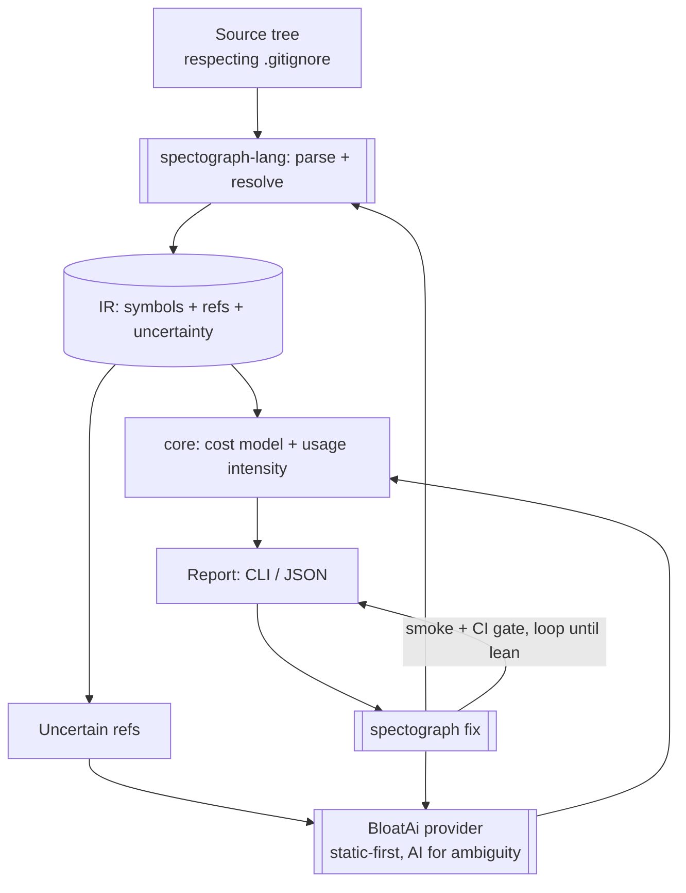

# Spectograph

Find where bloat lives. Per-language static + runtime analysis that attributes cost to
every symbol, ranks bloat as a cost-per-usage ratio, and drives a safety-isolated agent
loop that refactors a codebase lean — verified by the project's own smoke tests and CI.

---

## 1. Mission

Identify code that is "clearly taxing the system or app," regardless of whether it happens
to still work. Bloat is not only *dead code* (unreachable / unused) but any **high-cost,
low-usage** code: heavy modules pulled in for one cold call, import chains that drag the
whole app down, orphaned functions, unused imports, pullable dependencies.

The tool operates in two modes:

- **`spectograph check`** — read-only. Builds the cost/usage model and reports bloat.
- **`spectograph fix`** — mutating. Refactors the whole codebase in an isolated worktree,
  gated by smoke tests + CI, iterating until lean and fast enough.

---

## 2. Design contract (locked)

| Concern | Decision |
|---|---|
| Tool language | Rust workspace |
| Analyzed languages | Python, JS, TS, Go, Rust, Java, Kotlin, C, C++, Ruby (10) |
| Language depth | Uneven: Python/JS/TS deep first; C/C++ static-only first pass |
| Bloat definition | **cost / usage** ratio (not just reachability) |
| Cost signal | **Runtime profiling** (user entry commands + sampling, CPU first); static fallback when no workload |
| Dynamic refs | Static pass first; deterministic refactoring first; AI for ambiguous cases only |
| AI providers | Anthropic, OpenAI, Gemini, Amazon Bedrock, Google Vertex, Mistral, opencode zen, opencode go — **all treated equally**, none default |
| Scope | Everything except `.gitignore` (incl. nested/global); **per-language** only, no cross-language reachability |
| Output | CLI (human, tiered) + versioned JSON; nonzero exit for CI; `--fail-on <tier>` |
| `fix` safety | Edits in a **separate git worktree**; asks before merging to main |
| Correctness gate | smoke tests → full suite → green, within a time budget + bloat score under threshold |
| Agent loop | cost-effective, with thinking-loop detection + escape hatches |
| Scale | 10k → 1M LOC: batch for small, incremental index for large |

---

## 3. Workspace layout

Implemented so far:

```
spectograph/                     (Cargo workspace)
├── DESIGN.md                    ← this file (single source of truth)
├── README.md                    ← current implementation status
├── Cargo.toml
├── spectograph-core/           IR, cost model, bloat ranking, reporting
├── spectograph-cli/            the binary: check / fix subcommands
├── spectograph-analyzer/       analyzer trait + harness
├── spectograph-py/             Python analyzer
├── spectograph-js/             JS analyzer; shared React/Vue framework support
├── spectograph-ts/             TS analyzer; Angular support; reuses JS's React/Vue support
└── spectograph-tsserver/       shared typescript-language-server LSP client (spectograph-js + spectograph-ts)
```

Framework-specific support (React, Angular, Vue) is not a separate crate per framework —
it's layered additively inside `spectograph-js`/`spectograph-ts` on top of the same
symbol/reference graph the base analyzer builds, since a component is still an ordinary
symbol and framework facts (props, template-usage edges) are just extra data collected in
the same parse pass. See `spectograph-js/src/react.rs`, `spectograph-js/src/vue.rs`, and
`spectograph-ts/src/angular.rs`.

Not yet started — one crate each, following the same `Analyzer` trait as the languages
above:

```
├── spectograph-go/             Go analyzer
├── spectograph-rs/             Rust analyzer
├── spectograph-java/           Java analyzer
├── spectograph-kotlin/         Kotlin analyzer
├── spectograph-c/              C analyzer
├── spectograph-cpp/            C++ analyzer
└── spectograph-ruby/           Ruby analyzer
```

Each language crate parses and resolves references for its language and emits a
language-agnostic `Program`. All bloat logic lives once in `core`.

---

## 4. Shared IR (what every analyzer emits)

```rust
pub struct Program {
    pub symbols: Vec<Symbol>,
    pub references: Vec<Reference>,
    pub entrypoints: Vec<SymbolId>,
    pub language: Language,
    pub root: PathBuf,
}

pub struct Symbol {
    pub id: SymbolId,
    pub name: String,
    pub kind: SymbolKind,     // Function, Class, Import, Export, Const, Type, Module
    pub file: PathBuf,
    pub span: SourceSpan,
    pub reachable: bool,      // filled by core's reachability walk
    pub environment: Environment,  // Universal, Node, or Browser
    pub is_external: bool,    // third-party (e.g. node_modules) code, excluded from findings
}

pub struct Reference {
    pub from: SymbolId,
    pub to: SymbolId,
    pub kind: RefKind,        // Static, ReExport, Dynamic, Reflection, StringKeyed
    pub environment: Environment,
}
```

`core` only ever sees `Program`. Adding a language = one crate producing a `Program`.

---

## 5. Analysis pipeline



### 5.1 Cost model (runtime profiling)
- User-provided **entry commands** + sampling; attribute measured cost per symbol.
- **CPU time first**; memory/startup later phases.
- Static fallback (LOC, import-chain weight, estimated loops) when no workload is given,
  so the tool never dead-ends on a repo it can't run.

### 5.2 Uncertainty & AI providers
- Static pass marks uncertain references (`Dynamic`, `Reflection`, `StringKeyed`).
- `BloatAi` trait normalizes auth, streaming, tool-calling, token accounting across all
  nine providers. Provider selection is user config; none is privileged.
- **Deterministic refactoring first; AI only for ambiguous, high-impact cases** — cheaper
  and less prone to loop.

### 5.3 Bloat score
- `bloat = cost / usage`. High cost + low usage = bloat, regardless of reachability.
- Configurable per-symbol budget + ranking of top-N most expensive symbols.

---

## 6. Agent loop (`spectograph fix`)

Refactors the whole codebase. Structure:

```
iter 1: score 342, spend $0.03  ── remove 5 dead
iter 2: score 180, spend $0.02  ── merge 2 dup
iter 3: score 41,  spend $0.01  ── no improvement → LEAN ✓
```

- **Targeted context**: feed only top-N candidates ranked by bloat score + local context,
  never the whole repo.
- **Tiered models**: cheap/fast for disambiguation + low-risk removal; escalate to a bigger
  model only for ambiguous, high-impact refactors. Capped token budget per fix and per run.
- **Rerank each iteration**: recompute scores, re-analyze only affected files (incremental).

### 6.1 Thinking-loop detection (abort, don't spin)
Stop the loop when any fire:

- **Oscillation**: file state A→B→A→B.
- **Stall**: score stops improving across 2+ iterations (no monotonic gain).
- **No-op**: proposed fix produces an empty diff.
- **Revisit**: same candidate re-suggested after being handled.
- **Budget**: token budget or `--max-iterations` exhausted.

On abort: keep the best (lowest score) state seen and report *why* it stopped.

### 6.2 Safety & worktree isolation
- Agent edits live in a **separate git worktree**; nothing touches the main tree.
- **Correctness gate**: run the project's own smoke tests → full suite → green, within a
  time budget, plus bloat score under the configured threshold.
- Only after the gate passes does the tool **ask** before merging/opening a PR to the main
  worktree.
- Monotonic guard: reject any fix that increases total bloat score.
- Audit trail: per-iteration diff + score delta.

---

## 7. Output & CI

- `--format human` (default): tiered spectrograph-style table.
- `--format json`: versioned, machine-stable schema; consumed by CI and `fix`.
- Nonzero exit when bloat found; `--fail-on <tier>` for softer gates (e.g. fail only on 🔴).
- Tiers:
  - 🔴 guaranteed bloat (zero usage, all static)
  - 🟠 probably bloat (only dynamic/uncertain usage)
  - 🟡 high cost / low usage (used but taxing)

---

## 8. Scale

- **Small** (`< ~50k LOC`): one-shot batch, parse everything in memory.
- **Large** (`> ~50k LOC`): incremental index backed by a graph store (SQLite). Parse only
  dirty files, build the reference graph incrementally, chunk analysis so the AI provider
  never sees the whole repo at once. The IR is identical; only plumbing changes.

---

## 9. Config surface (initial)

- `.gitignore` honored by default; explicit include-overrides allowed.
- Entry/test/CI commands per repo and per language.
- Bloat budget + `--fail-on` tier.
- Provider selection + credentials (config file + env vars, OS keychain for secrets).
- Scale thresholds, time budgets, `--max-iterations`.
